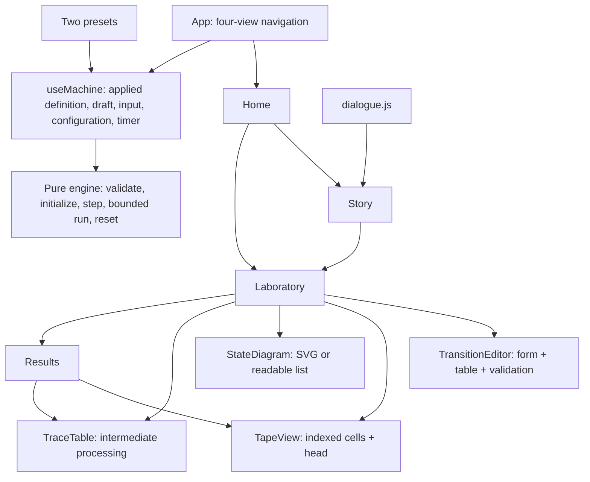

# Project Enigma

**The Codebreaker Chronicles** · CSET302 — Automata Theory & Computability

A small, local educational application: a dark Bletchley Park introduction followed by an editable, deterministic Turing machine laboratory. The four views are Home, Story (four short scenes), Laboratory, and Results. The laboratory works directly from Home without playing the story.

Enigma was a rotor cipher. The wartime Bombe and a formal Turing machine are different devices. The setting and Alan Turing dialogue are fictionalized educational material, not historical quotations. The crib exercise is a simplified necessary consistency check; **this application does not decrypt Enigma**.

## Run locally

Use Node.js **22.12 or newer** (Node 22 or 24 LTS recommended). In this folder:

```sh
npm install
npm run dev
```

Open the local URL printed by Vite, normally **http://127.0.0.1:5173**. Stop it with Ctrl+C. No account, backend, API key, paid service, or runtime internet connection is needed. Package installation needs internet once; all fonts and artwork are local.

This Windows workspace also contains a checksum-verified portable Node runtime in the ignored `.tools/` folder because Node was initially absent from PATH. The launcher finds that runtime without changing your system configuration:

```powershell
.\enigma.cmd install
.\enigma.cmd dev
.\enigma.cmd test
.\enigma.cmd build
```

On another computer, install Node normally and use the standard npm commands. The portable runtime is an environment convenience, not part of the source distribution.

## Verify

```sh
npm test                # Pure-engine Vitest suite, exits after one run
npm run test:watch      # Optional watch mode
npm run build          # Optimized static files in dist/
npm run preview        # Serve dist/ locally, normally port 4173
```

Browser verification uses Playwright as a development dependency and tests the actual production build:

```sh
npm run build
npm run test:browser
```

On this Windows machine it uses the installed Google Chrome in headless mode. On another machine, set `ENIGMA_BROWSER_PATH` to a Chrome/Chromium executable, or install Playwright's Chromium with `npx playwright install chromium`. Browser verification creates local screenshots and a JSON report in ignored `artifacts/`; none of this is required to run the app. Close another preview server on port 4173 before starting the check. Windows launcher equivalent: `enigma.cmd test:browser`.

## A beginner’s field guide

1. Choose **Turing Machine Laboratory** on Home, or play the four-scene introduction.
2. Choose a preset. Type a string made from its **input alphabet Σ**, then choose **Load input**. Empty input is valid; do not type the blank symbol.
3. Choose **Step** for exactly one transition. Watch the highlighted tape cell, current state, state map, and execution trace. **Run** schedules transitions at the selected speed; **Pause** cancels the next timer.
4. Edit states as a comma-separated list. Add or remove names there, and update affected rules. Edit the input/tape alphabets, blank, and start/halting states in the same panel.
5. Change, add, or delete rules in the transition table. **Apply definition** validates the definition and current input, then restarts the machine. Changes are never silently applied mid-run. Execution controls stay disabled while edits are pending.
6. When execution stops, choose **Review results**. You will see the initial input, final tape, head context, final state, transition count, and complete trace. **Back to lab** preserves the applied definition and run; **Reset & retry** restarts the same input.

**Reset** always restores the last loaded input, initial state, head 0, and empty trace. Unapplied rule edits remain in the editor; apply them before stepping. Loading a preset replaces the current definition and input with its supplied example. Leaving the lab pauses execution. State is kept in memory for this browser session; refreshing starts over.

### Status meanings

| Status | Meaning |
| --- | --- |
| Ready | Definition and input loaded; no transition executed |
| Running | A timer is scheduling transitions |
| Paused | Between transitions; safe to inspect or resume |
| Accepted | Entered the designated accept state |
| Rejected | Entered the designated reject state |
| Halted (no transition) | No rule for the current state/read symbol; no accept/reject verdict |
| Step limit reached | Stopped at the safety bound; no accept/reject verdict |
| Error | A definition/input validation error needs correction |

## Formal model and semantics

`M = (Q, Σ, Γ, δ, q0, qAccept, qReject)`

| Element | Implementation |
| --- | --- |
| Q | Finite list of distinct state names |
| Σ | Input alphabet; excludes blank and is a subset of Γ |
| Γ | Tape alphabet, including blank; one Unicode code point per symbol |
| δ | Partial deterministic mapping `(state, read) → (write, move, nextState)` |
| q0 | A member of Q; head starts at integer index 0 |
| qAccept, qReject | Distinct members of Q with no outgoing transitions |
| Tape | `Map<integer, symbol>`; absent entries mean blank, including negative indices |
| L / R / S | Decrease head by 1 / increase by 1 / leave it in place |

The input occupies cells `0 … n−1`; the rest of the tape is blank. Empty input starts on blank cell 0. A transition reads the current cell, writes (deleting a Map entry when writing blank), moves the head, changes state, and appends exactly one trace row. The row records both the head before and after moving; the displayed **Head** column is the latter. A missing rule appends no row because no transition occurs.

The engine is pure: it creates a new configuration, Map, and trace on each transition, preserving earlier configurations. Entering a halting state takes precedence over the safety bound on that same transition. Initially halting states are supported for custom machines; the supplied presets have separate nonhalting start states. Halting configurations cannot execute more transitions.

The default bound is **1,000 total transitions per reset**, shared by Step and Run. It is configurable as `DEFAULT_STEP_LIMIT` in `src/engine/turingMachine.js`; the pure runner also takes an explicit limit. A limit outcome is terminal until Reset. The React interface uses one cancellable timeout per transition, keeping even a nonhalting definition responsive.

Definition validation rejects duplicate `(from, read)` keys, unknown states/symbols, invalid moves, invalid alphabets/blank, repeated names, overlapping accept/reject states, and outgoing halting rules. Input is validated before initialization. An absent transition is permitted because δ is partial.

### Engine pseudocode

```text
initialize(definition, input):
    validate definition; validate input against Σ
    tape := Map(input characters at indices 0 ... n−1)
    head := 0; state := q0; steps := 0; trace := []
    status := initial halting verdict, otherwise Ready

step(definition, configuration):
    if already terminal: return configuration unchanged
    if state is accept/reject: halt with that verdict
    if step count reached limit: stop with Step limit reached
    read := tape[head], or blank if absent
    rule := δ(state, read)
    if no rule: halt with Halted (no transition), without a new trace row
    copy tape; write rule.write at head
    head := head + direction offset (L: −1, R: +1, S: 0)
    state := rule.nextState
    increment steps; append read/write/move/state/head trace row
    check accepting/rejecting state, then step bound; otherwise Paused

run in UI:
    schedule one step after the speed delay
    if still Running and nonterminal: schedule the next step
    cancel scheduled work on Pause, Reset, edits, preset, navigation, or unmount
```

## The two experiments

### 01 — Binary string ends in 1

`Σ = {0, 1}`, `Γ = {0, 1, _}`, blank `_`. States are `qStart`, `qLast0`, `qLast1`, `qAccept`, `qReject`. The last-symbol states remember which character was most recently read; the machine never needs to move left.

| Current state | Read 0 | Read 1 | Read _ |
| --- | --- | --- | --- |
| qStart | write 0, R, qLast0 | write 1, R, qLast1 | write _, S, qReject |
| qLast0 | write 0, R, qLast0 | write 1, R, qLast1 | write _, S, qReject |
| qLast1 | write 0, R, qLast0 | write 1, R, qLast1 | write _, S, qAccept |

`101` and `1` accept. `100` and empty input reject. For length n, a complete run uses n+1 transitions, including the final blank check.

**Manually derived example: `101`**

| Step | State before | Read | Write | Move | State after | Head after |
| --- | --- | --- | --- | --- | --- | --- |
| 1 | qStart | 1 | 1 | R | qLast1 | 1 |
| 2 | qLast1 | 0 | 0 | R | qLast0 | 2 |
| 3 | qLast0 | 1 | 1 | R | qLast1 | 3 |
| 4 | qLast1 | _ | _ | S | qAccept | 3 |

Final verdict: **Accepted**, tape content `101`, head 3. The automated oracle test independently checks every binary string through length 8 against JavaScript’s `endsWith('1')`.

### 02 — Enigma-inspired crib alignment check

`Σ = {D, S}`, `Γ = {D, S, _}`, blank `_`. `D` means the plaintext and ciphertext differ at that position; `S` means they match. The start state is `qScan`.

| Current state | Read | Write | Move | Next state |
| --- | --- | --- | --- | --- |
| qScan | D | D | R | qScan |
| qScan | S | S | S | qReject |
| qScan | _ | _ | S | qAccept |

`DDDDD` accepts after 6 transitions, `DDSDD` rejects after 3, and empty input accepts after 1. Empty input vacuously contains no same-letter position. Passing this check is only a necessary consistency condition; it neither verifies rotor settings nor decrypts a message.

## Architecture



| File | Responsibility |
| --- | --- |
| `src/engine/turingMachine.js` | Pure formal semantics and validation; independent of React |
| `src/engine/turingMachine.test.js` | Preset verdicts, oracle checks, tape semantics, limits, reset, validation |
| `src/hooks/useMachine.js` | Applied/draft definitions, input, execution state and timer lifecycle |
| `src/data/presets.js` | Both complete machine definitions and beginner hints |
| `src/data/dialogue.js` | All four editable story scenes |
| `src/components/` | Home, Story, Laboratory, Results, tape, editor, diagram, trace, modal, icons, atmosphere |
| `src/App.jsx` | Four view states and session preservation |
| `src/App.css` | Dark palette, responsive layouts, focus styles, reduced motion |
| `public/images/` | Original local silhouette/room artwork, designed for easy replacement |
| `scripts/browser-check.mjs` | End-to-end production-browser checks and screenshots |

Implementation followed the PRD phases: (1) skeleton + pure engine + presets + tests; (2) usable lab/editor/trace/results; (3) Home/story/artwork/styling; (4) tests, production verification and documentation. Runtime dependencies are only React and React DOM. Vite, its React plugin, Vitest and Playwright are development tools. No router, state library, graph library, animation dependency, external fonts or APIs are used.

## Manual demo checklist and validation record

The expected observations below are also exercised by the automated browser check. See `VERIFICATION.md` for the recorded execution results and `artifacts/browser-report.json` for the generated per-check report.

| Action | Expected observation |
| --- | --- |
| Home → Begin investigation | First of exactly four short scenes |
| Next, Back, Skip to laboratory | Correct scene progression; direct lab access |
| Home → Turing Machine Laboratory | Lab without story |
| Load `101`; Step once | qLast1, head 1, one trace row |
| Run to completion | Accepted; 4 transitions; controls stop |
| Review results → Back to lab | Same definition, configuration and full trace |
| Reset & retry | Input `101`, qStart, head 0, 0 transitions |
| Load `100`, then empty binary input | Rejected in 4, then 1 transition |
| Load invalid `10X` | Actionable X error; Run disabled |
| Crib `DDSDD`, `DDDDD`, empty | Rejected / Accepted / Accepted |
| Binary rule 9: target qReject; Apply | `101` now rejects; the edit changes execution |
| Add duplicate rule; Apply | Clear duplicate-key error, invalid row highlighted |
| Add qNew to States; Apply | New state appears; larger machines use a rule-list graph fallback |
| Delete qStart/read 1 rule; Apply; Step on `101` | Halted (no transition), not Rejected |
| Crib D rule: move L; blank rule: write D; input D | Head reaches −1, reads blank, writes D; final content DD |
| Run a long input; Pause; wait | Count remains unchanged; Reset and navigation cancel the timer |
| Loop blank rule on qScan, move L; Run empty | Step limit reached at 1,000, not Rejected |
| Tab through Field guide; Escape | Focus contained in dialog; Escape closes and restores focus |
| Resize to 1100, 768, 390 px | Functional controls and forms; no page overflow |

### A 2–3 minute presentation

1. Show Home and its direct laboratory option. Open the story, advance once, then Skip.
2. Load binary `101`. Step once: read 1, write 1, move right, qStart → qLast1. Point out the tape, state map and trace. Run to Accepted.
3. Review the result and Reset & retry. Load `100` and Run to Rejected.
4. Select the crib exercise: `DDSDD` rejects on S; `DDDDD` accepts. Explain the limited classroom analogy.
5. Change a transition, Apply definition and Run again. Explain deterministic keys and how validation prevents ambiguous rules.
6. Explain the engine’s pseudocode: a Map models an infinite tape, one step applies one rule, and a bounded timer keeps the browser responsive. Distinguish rejection from a missing rule and the safety bound.

## Design and limits

The approved `approved-dark-ui.png` in this workspace was inspected as the visual reference. Home and Story rebuild its cream serif typography, charcoal dialogue panel, muted red accents, brass, lamp-lit equipment, left character presence and right navigation as actual components. The reference bitmap is never displayed as the interface. Original SVG placeholders are documented in `public/images/README.md`; they are intentionally stylized rather than photographic likenesses.

- A deterministic, single-tape model only; no nondeterminism, multiple tapes, real cryptanalysis, or Bombe reconstruction.
- Single-character Unicode symbols. The practical editor uses comma-separated lists; whitespace and commas are not supported as list symbols. All other entered input is checked against Σ.
- Long/complex graphs use a complete scrollable state/rule list. Small graphs pair SVG nodes/edges with a readable transition legend.
- Tape is conceptually unbounded; the UI shows 11 cells around the head (fewer fully visible on narrow phones), and the execution safety bound is finite.
- Trace history is in memory, capped by the step limit. Final content retains interior blanks and omits blank outer margins; final head context is shown separately.
- No persistence across reloads, file import/export, authentication, sound or branching narrative. These are deliberately outside scope.
- Desktop and tablet are the primary targets. Smaller layouts stack panels and keep the transition editor usable.

## Course source

**CSET302 — Automata Theory and Computability, Consolidated Plan (2026), pp. 3–4**, as summarized in the supplied [PRD, §2](docs/PRD.md#2-course-rubric-and-scope-constraints). The course workflow is *User Input → Algorithm → Step-by-Step Processing / Visualization → Result → Validation*. The original university plan PDF and institution name were not included in this workspace; this citation preserves the handoff’s attribution without claiming independent access to that document.

Tool setup references: [Node.js official distribution](https://nodejs.org/), [Vite guide](https://vite.dev/guide/), [Vitest guide](https://vitest.dev/guide/). Exact installed versions are locked in `package-lock.json`.
